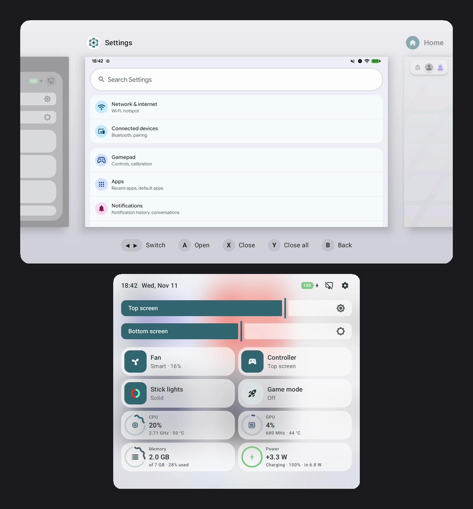
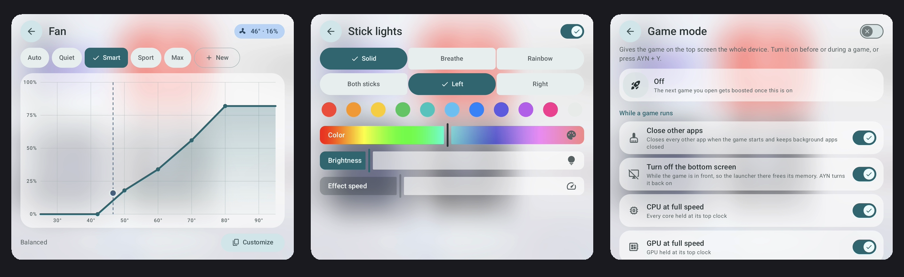
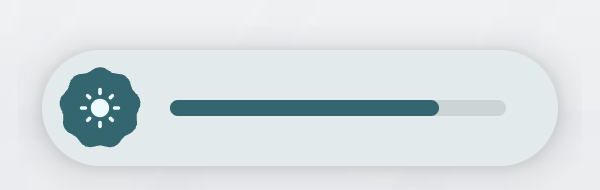
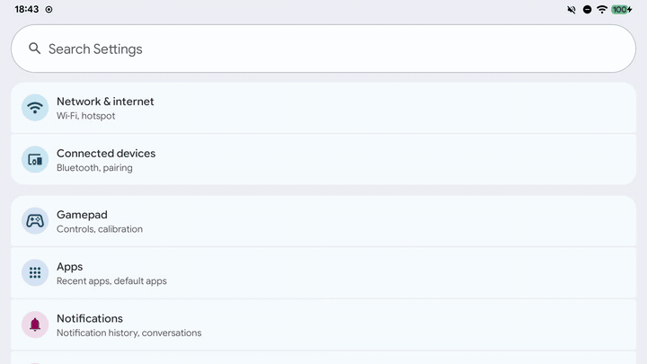
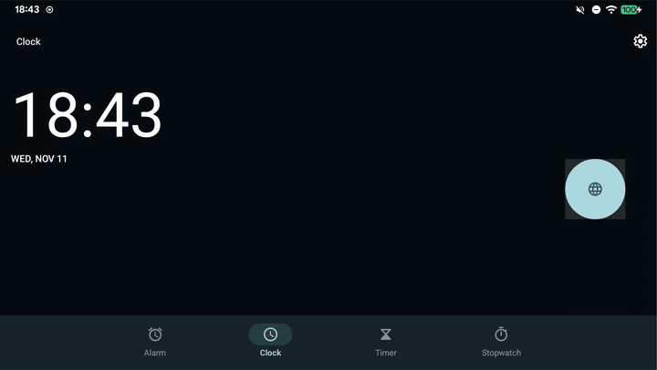
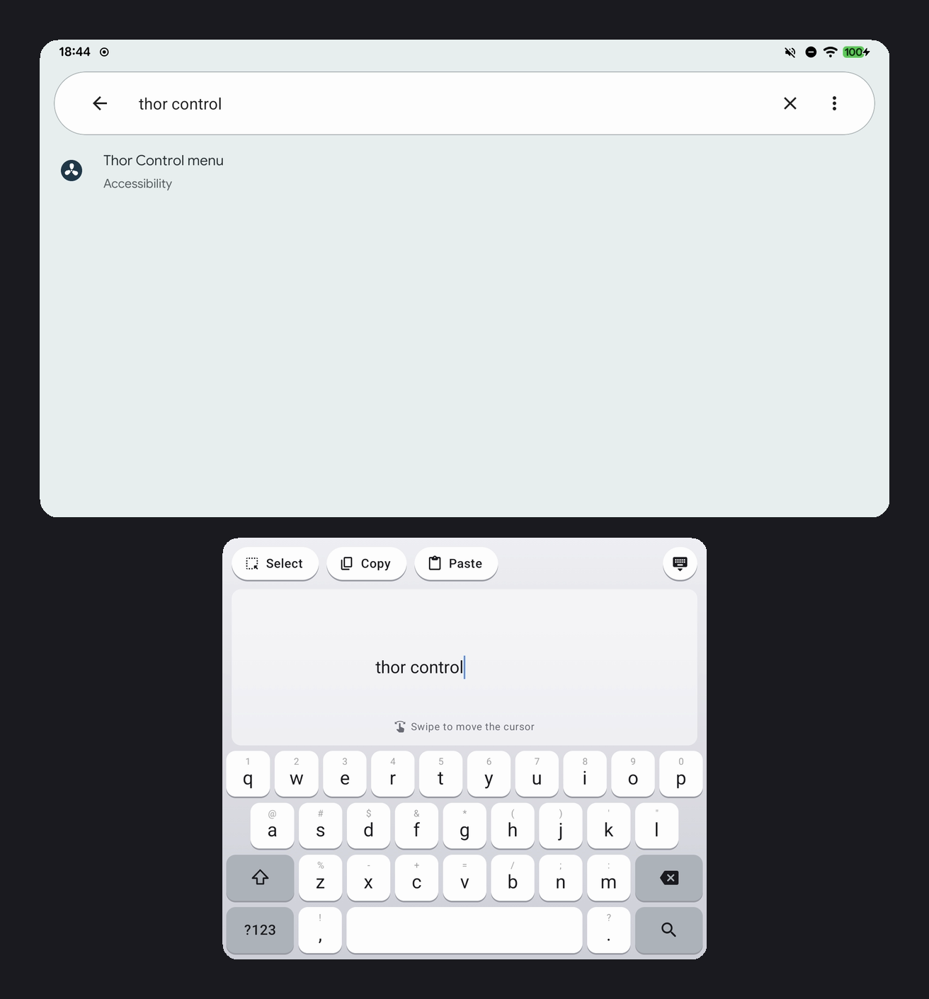
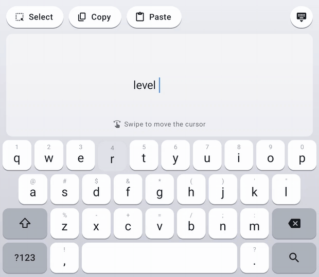
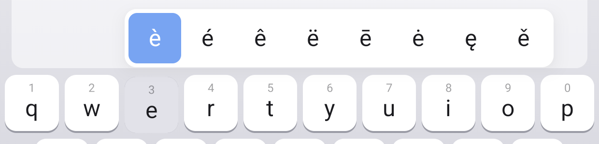

<h1 align="center">Thor Control</h1>

<p align="center">
  <b>Make the AYN Thor feel like it was built for LineageOS.</b><br>
  One Magisk module for the Thor on LineageOS 24 (Android 17): a quick menu on the bottom screen,
  fan curves, brightness per screen, controller routing, game mode, a new recent apps screen and
  a dual-screen keyboard. And about 400 MB more free memory.
</p>

<p align="center">
  
</p>

<p align="center">
  <a href="https://github.com/timklop/thor-control/releases/latest"><b>Download the latest release</b></a>
  &nbsp;·&nbsp; <a href="#install">Install</a>
  &nbsp;·&nbsp; <a href="#how-to">How-to</a>
  &nbsp;·&nbsp; <a href="#cheat-sheet">Cheat sheet</a>
  &nbsp;·&nbsp; <a href="docs/HOW-IT-WORKS.md">How it works</a>
</p>

---

## Why

LineageOS on the Thor is great, but it treats the second screen and the built-in controller as an
afterthought: no fan control, both screens share one brightness, the controller goes wherever it
likes, the bottom screen has a status bar you can't use, and the system keeps hundreds of
megabytes of memory locked away from your games. Thor Control fixes all of that, and puts the
controls one button press away.

## What you get

### A quick menu on the bottom screen

Tap the **AYN button** and a menu in the style of Android 17's quick settings slides over the
bottom screen, above any app or game. Two brightness sliders (one per screen), the fan, the
controller, the stick lights and game mode, plus live CPU, GPU, memory and power readings. Tap a
tile's round icon for the quick action, or the rest of the tile for its page.

<p align="center"></p>

### Fan profiles and your own curves

Auto (LineageOS decides), Quiet, Smart, Sport and Max, or draw your own curve by dragging points.
Above 90 °C the fan always goes to full speed, and with the lid closed it stops (unless the chip
or the charging port is still hot).

### Brightness per screen

Each screen gets its own brightness, from the menu or straight from the controller:
**AYN + L1 / R1** for the bottom screen, **AYN + L2 / R2** for the top one. A small pill shows the
level on the screen you're changing.

<p align="center"></p>

### The controller goes where you want

Send the built-in controller to the top screen, the bottom screen, or let it follow whichever
screen you touched last. Move the app you're using from one screen to the other with one combo.

### Game mode

Press **AYN + Y** in a game and the Thor is all its: other apps close, background apps stay
closed, the CPU and GPU are held at their top clocks, the fan switches to Sport, and the bottom
screen turns off so the launcher there gives back its memory. Every part is a switch you can turn
off. The game itself is never closed, and everything goes back to normal when you leave it or
the screen turns off.

### Recent apps, rebuilt for a controller

Hold **Home** and the app you're in zooms out into a row of cards, with the home screen always
on the far right. Flick or press ◀ ▶ to move, **A** to open, **X** to close an app, **Y** to
close all. A quick press of Home slides you over to the home screen in the same motion.

<p align="center">
  
  &nbsp;
  
</p>

### Thor Keyboard: type on the bottom screen

Whichever screen the text field is on, the keyboard appears on the bottom screen, so it never
covers what you're typing into. The top half is a **touchpad**: swipe to move the cursor one
character at a time (with a tick for every character), tap **Select** to mark text, then **Copy**
or **Paste**. The keys work like an iPad's: every key shows a number or symbol above its letter.
**Swipe down** on the key to type it, and **hold** a key for its accents.

<p align="center">
  
  &nbsp;
  
</p>
<p align="center"></p>

### A leaner system

About 400 MB of extra free memory, without losing anything you use: Android stops locking files in
memory, Trebuchet (only needed for gesture navigation and recents, both replaced) is switched off,
services for hardware the Thor doesn't have are stopped, and swap compresses better. The
[details](docs/HOW-IT-WORKS.md#memory) are in How it works.

### And a few fixes

* The bottom screen has no status bar or notification shade, and the top screen no navigation
  bar: the hardware Home and Back buttons do that job, so apps get the full height.
* Auto-rotate works the right way round (LineageOS had the motion sensors 90° off).
* Cocoon shows LineageOS's Browser and Gallery in "All apps".
* If the bottom screen boots up dark, Thor Control wakes it.
* Stick lights: solid, breathing or rainbow, per stick or both, any colour.

---

## Install

**You need:** an AYN Thor running LineageOS 24 (Android 17), rooted with
[Magisk](https://github.com/topjohnwu/Magisk).

1. Download **`ThorControl-magisk.zip`** from the
   [latest release](https://github.com/timklop/thor-control/releases/latest).
2. Open the **Magisk** app → **Modules** → **Install from storage**, and pick the zip.
3. Tap **Reboot**.
4. Press the **AYN button**. The menu should slide up on the bottom screen.
5. Make Thor Keyboard your keyboard: **Settings › System › Keyboard › On-screen keyboard**,
   or over adb:

   ```sh
   adb shell ime set com.thorctl/.app.ThorKeyboard
   ```

Everything else happens on its own: the menu's accessibility service is switched on (and kept on),
the memory savings are applied on every boot, and the app shows up as **Thor Control** in your
launcher.

**Updating:** install the new zip the same way and reboot. Your settings are kept.

**Removing:** in Magisk, remove the module (or switch it off) and reboot. The fan goes back to
LineageOS right away, and Trebuchet and the stopped services come back. The navigation bar
returns after the reboot.

## How-to

<details open>
<summary><b>Open the menu</b></summary>

Tap the **AYN button** (the menu stays until you tap it again). Each tile has two halves: the round
icon does the quick action (next fan profile, next controller target, lights on/off, game mode
on/off), the rest of the tile opens its page. The icons in the top right turn the bottom screen off
and open the full Thor Control app on the top screen.
</details>

<details>
<summary><b>Pick a fan profile, or make your own</b></summary>

Open the **Fan** tile. Tap a profile to use it: **Auto** hands the fan to LineageOS, the others
follow their curve. The dashed line and the dot show the current temperature and fan speed.
To make your own, tap **Customize** (or **New**): you get a copy called "Custom 1" that you can
shape by dragging its points. **Duplicate** and **Delete** manage your own profiles.
</details>

<details>
<summary><b>Change the brightness of one screen</b></summary>

Drag the **Top screen** or **Bottom screen** slider in the menu. Without opening the menu: hold
**AYN** and press **L1 / R1** (bottom screen, dimmer / brighter) or **L2 / R2** (top screen).
Each press is one 10 % step.
</details>

<details>
<summary><b>Send the controller to a screen</b></summary>

Hold **AYN** and press **D-pad ▲** for the top screen, **▼** for the bottom screen, or **◀ / ▶** to
let the controller follow whichever screen you touched last. The **Controller** tile does the same.
</details>

<details>
<summary><b>Move an app to the other screen</b></summary>

**AYN + B** moves the app on the top screen down, **AYN + X** moves the app on the bottom screen up.
</details>

<details>
<summary><b>Turn the bottom screen off (and back on)</b></summary>

Tap the screen-off icon at the top right of the menu. Tap **AYN** to turn it back on.
</details>

<details>
<summary><b>Use game mode</b></summary>

Start your game, then press **AYN + Y** (or tap the round icon on the **Game mode** tile). You can
also turn it on first: the next game you open becomes "the game". Open the tile to choose what it
does: close other apps, turn off the bottom screen, CPU and GPU at full speed, and the fan profile
while playing. Games that use both screens keep the bottom screen on; if a game needs it anyway,
tap **AYN** and it stays on for that game. Press **AYN + Y** again to switch game mode off.
</details>

<details>
<summary><b>Switch between apps</b></summary>

Hold **Home** for half a second. The app you're in becomes a card in the middle, your other apps
are to the left, and the home screen is on the far right.

| | Controller | Touch |
|---|---|---|
| Move | ◀ ▶, left stick or L1 / R1 (hold to keep going) | Flick left / right |
| Open | **A** | Tap a card |
| Close an app | **X** | Swipe the card up |
| Close all | **Y** | |
| Go back | **B** or **AYN** | Tap the background |
| Home | **Home**, or move onto the home card | Tap the home card |
</details>

<details>
<summary><b>Type with Thor Keyboard</b></summary>

* **Numbers and symbols:** swipe down on a key to type the small character above it, or tap
  **?123**. On the ?123 page, swipe down for the **=\\<** page.
* **Accents:** hold a key (like **e**), slide along the strip and let go.
* **Capitals:** tap **⇧** for one, double-tap for caps lock, or press **L1 / R1** on the controller.
* **Delete words:** swipe left from **⌫**: every bit further selects one more word back (swipe back
  to give them back). Let go to delete them. Hold ⌫ to delete letter by letter.
* **Move the cursor:** swipe across the touchpad; you feel a tick for every character.
* **Select, copy, paste:** tap **Select**, swipe to mark the text, tap **Copy**. **Paste** puts in
  what's on the clipboard.
* **Hide it:** the keyboard button at the top right, or **Back**.
</details>

## Cheat sheet

| Button | What it does |
|---|---|
| **AYN** | Open / close the menu (or wake the bottom screen) |
| **AYN + ▲ / ▼** | Controller → top / bottom screen |
| **AYN + ◀ / ▶** | Controller follows focus |
| **AYN + B / X** | Move app down / up |
| **AYN + Y** | Game mode on / off |
| **AYN + L1 / R1** | Bottom screen dimmer / brighter |
| **AYN + L2 / R2** | Top screen dimmer / brighter |
| **Home** | Go home (animated) |
| **Home (hold)** | Recent apps |
| **L1 / R1** while typing | Shift |

While you hold **AYN** the game doesn't see any of these buttons.

## Troubleshooting

**The menu doesn't open.** Thor Control draws the menu through an accessibility service. Check
**Settings › Accessibility › Thor Control menu** is on. Thor Control turns it back on by itself
within half a minute.

**The keyboard on the bottom screen doesn't show up.** Thor Keyboard has to be chosen as your
keyboard once (see [Install](#install), step 5).

**The bottom screen stays black after a reboot.** That's a LineageOS quirk; Thor Control power-cycles
the panel after a few seconds. Tapping **AYN** also wakes it.

**I miss swipe navigation.** Gesture navigation came from Trebuchet, which Thor Control switches
off to save memory. Switching the module off in Magisk brings both back after a reboot.

**Where are the logs and settings?** `/data/adb/thorctl/daemon.log`, `logcat -s thorctld` and
`/data/adb/thorctl/config.json`.

## Under the hood

A small root service does the hardware work (fan, clocks, lights, displays, the controller) and a
system app draws the menu, recents and keyboard in overlay windows that sit above everything. The
whole story, the memory numbers and the build steps are in
**[How it works](docs/HOW-IT-WORKS.md)**.

```sh
./build-module.sh      # builds out/ThorControl-magisk.zip (needs the Android SDK and JDK 17)
```

---

<sub>Not affiliated with AYN, LineageOS or Cocoon. Thor Control changes system settings as root;
use it at your own risk. Removing the module undoes its changes.</sub>
